# Implicit State Machines

Verificado contra el código el 2026-11-04 (v1.0.1, commit `dd6cfa6`).

## 1) Alcance y método

Este documento llama "máquina de estados implícita" a cualquier entidad que
pasa por un conjunto finito de estados a lo largo del tiempo, cuando el código
no la modela como un tipo cerrado con una sola función de transición. El
estado vive en booleanos, en `Option`, en la presencia de archivos, en
variables locales de un bucle o en mensajes entre el navegador y el servidor.

Método de búsqueda:

1. Lectura completa de `src/` (`server.rs`, `jobs.rs`, `ffmpeg.rs`,
   `plan.rs`, `install.rs`, los dos binarios y el JavaScript de `ui.html`).
2. Rastreo de cada campo mutable de `AppState`, `Entry`, `SetupState` y del
   objeto `state` de la página, y de cada archivo que el programa crea o borra.
3. Rastreo de cada bucle cuyo resultado depende de iteraciones anteriores
   (escaleras, pasadas, parsers).
4. Contraste con `docs/codebase/CONCERNS.md`. Los bugs de colisión de nombres
   (`99cc31f`) y de orientación EXIF (`d5b8eff`) están cerrados y este
   documento no los trata como abiertos.
5. Una comprobación en vivo: se compiló `resizer` en un directorio temporal y
   se llamó a la API con la misma función `api()` que usa `ui.html`. El
   resultado aparece en la máquina 3.1.

Cada riesgo lleva la marca **verificado** (leído en el código o reproducido)
o **hipótesis** (depende de tiempos, del sistema operativo o de ffmpeg).

## 2) Resumen

| # | Máquina | Codificación del estado | Archivo principal | Riesgo principal |
|---|---------|-------------------------|-------------------|------------------|
| 3.1 | Tanda de conversión de la GUI | `Entry.status` + `AppState.converting` + `pollTimer` en la página | `src/server.rs`, `src/ui.html` | La página envía `GET /api/convert`; el servidor solo acepta `POST`. La GUI nunca arranca una conversión (verificado) |
| 3.2 | Archivo de salida en disco | Presencia del archivo, tamaño, nombre planificado | `src/jobs.rs` | Un proceso muerto deja un archivo reclamado o parcial; la re-ejecución lo cuenta como ocupado y lo deja ahí (verificado) |
| 3.3 | Pasadas de video y passlog | Índice del bucle de pasadas + archivos `x264-pass-*` en el scratch | `src/jobs.rs`, `src/ffmpeg.rs` | `cleanup_passlog` borra por prefijo: el job 1 borra el passlog del job 10 a 19 (verificado el prefijo; efecto hipótesis) |
| 3.4 | Presupuesto de peso | `max_mb: Option<f64>`, rama PNG, peldaño de la escalera | `src/jobs.rs`, `src/plan.rs` | JPG/WebP en el último peldaño y video bajo el piso de bitrate terminan en éxito por encima del presupuesto (verificado) |
| 3.5 | Instalación de ffmpeg | `SetupState.installing` + `error` + `Ctx.tools` + archivos en `data_dir()` | `src/server.rs`, `src/install.rs`, `src/ui.html` | Con `FFMPEG_PATH` roto, toda instalación termina en error sin salida (verificado) |
| 3.6 | Vista previa | Archivo `preview-{id}.*` + `state.preview` + clase `open` del modal | `src/jobs.rs`, `src/server.rs`, `src/ui.html` | Cerrar el modal durante la generación no cancela nada; el modal se reabre al llegar la respuesta (verificado) |
| 3.7 | Ingesta de archivos | Directorio `in-{id}` + archivo temporal + `Entry` | `src/server.rs` | Una subida rechazada deja el directorio `in-{id}` vacío (verificado) |
| 3.8 | Proceso hijo ffmpeg y progreso | Variables locales del bucle de `stdout` + hilo de `stderr` | `src/ffmpeg.rs` | Sin timeout (ya en CONCERNS). La máquina es sólida |
| 3.9 | Pool de workers | Cola `mpsc` vacía/cerrada + vector de `Option<BulkItemResult>` | `src/jobs.rs` | Ninguno nuevo. La máquina es sólida |
| 3.10 | Ajustes y modo de tasa | `max_mb` (Some/None) + panel de la página + debounce | `src/plan.rs`, `src/ui.html`, `src/bin/resizer-cli.rs` | El botón 4:5 enciende el límite y el silencio; los otros ratios no los apagan (verificado; quizá intencional) |
| 3.11 | Parsers EXIF | Índice `i` + tipo de marcador o chunk | `src/ffmpeg.rs` | Ninguno. La máquina es sólida |

## 3) Máquinas

### 3.1) Tanda de conversión de la GUI

**Propósito.** Llevar cada archivo de la lista de la GUI desde "listo" hasta
"hecho" o "error", con una sola tanda activa a la vez.

**Dónde.**

- Estado por archivo: `src/server.rs:22-29` (`Status`), `src/server.rs:31-46`
  (`Entry`: `status`, `progress`, `out_path`, `out_size`, `error`).
- Estado global: `src/server.rs:53` (`converting`).
- Entrada a `Working`: `src/server.rs:578-591`.
- Hilo de la tanda: `src/server.rs:594-640`; snapshot en `src/server.rs:595-607`;
  callback de progreso y cierre en `src/server.rs:618-637`; fin en
  `src/server.rs:639`.
- Vaciado: `src/server.rs:645-659`.
- Rutas: `src/server.rs:284-291` (solo `Method::Post`).
- Página: `api()` en `src/ui.html:458-469`; botón convertir en
  `src/ui.html:898-904`; vaciar en `src/ui.html:905-907`; abrir carpeta en
  `src/ui.html:908`; polling en `src/ui.html:583-596` y `src/ui.html:911-913`;
  botón deshabilitado en `src/ui.html:579`.

**Codificación.** `Status` es un enum explícito, pero el estado real es la
combinación de `status`, `progress`, `out_path`, `out_size`, `error` y del
booleano global `converting`. En la página, el estado se reparte entre
`state.converting`, `pollTimer` (null o intervalo de 700 ms) y el intervalo
fijo de 4 s. Ningún sitio tiene la imagen completa: el servidor decide los
estados y la página los deduce por polling.

**Estados y transiciones.**

| Desde | Hacia | Disparador | Dónde |
|-------|-------|------------|-------|
| (nada) | `Ready` | subida o carpeta aceptada | `src/server.rs:448`, `src/server.rs:510` |
| `Ready` | `Working` | `POST /api/convert` con `converting == false` | `src/server.rs:586-590` |
| `Working` | `Done` | callback con `Ok` | `src/server.rs:625-629` |
| `Working` | `Error` | callback con `Err` | `src/server.rs:630-633` |
| cualquiera | (borrada) | `POST /api/clear` con `converting == false` | `src/server.rs:650-657` |
| tanda `Idle` | tanda `Running` | mismo `POST /api/convert` | `src/server.rs:586` |
| tanda `Running` | tanda `Idle` | `run_bulk` retorna | `src/server.rs:639` |

`Done` y `Error` son terminales por archivo. No hay reintento: un archivo
con error solo sale de la lista con "vaciar". Un archivo que llega durante una
tanda queda en `Ready` y espera a la tanda siguiente, porque el hilo solo toma
los `Working` (`src/server.rs:600`).

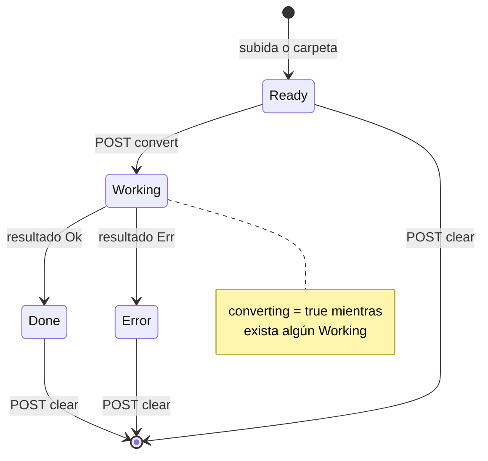

**Invariantes.**

- I1. A lo sumo una tanda a la vez. Se cumple: la comprobación y el cambio de
  `converting` ocurren bajo el mismo lock (`src/server.rs:579-586`).
- I2. `converting == true` si y solo si existe algún `Working`. Se cumple solo
  si el hilo llega a `src/server.rs:639`. Ningún guard lo asegura ante un
  panic.
- I3. "Vaciar" nunca borra un archivo que un worker lee. Se cumple con el 409
  de `src/server.rs:647-649`.
- I4. Los ids nunca se reutilizan (`next_id` atómico, `src/server.rs:63`).
  Se cumple; por eso una previa vieja nunca se sirve para otra entrada.

**Riesgos.**

- **R1 (verificado, alto).** La función `api()` de la página usa `GET` cuando
  no recibe cuerpo (`src/ui.html:460`). Las llamadas `api("/api/convert")`,
  `api("/api/clear")` y `api("/api/open-output")` (`src/ui.html:901`,
  `src/ui.html:906`, `src/ui.html:908`) salen como `GET`. El servidor solo
  enruta esas rutas con `Method::Post` (`src/server.rs:284-286`) y responde
  404. Reproducido el 2026-11-04 contra el binario de este commit:
  `/api/folder` devuelve 200, y `api("/api/convert")` y `api("/api/clear")`
  devuelven `404 {"error":"not found"}`; la entrada sigue en `ready`. Efecto:
  desde la GUI ninguna entrada llega a `Working`. "Vaciar lista" falla con un
  toast "not found". "abrir" falla en silencio por el `.catch(() => {})`. El
  defecto existe desde el primer commit (`35635c4`). Ningún test lo cubre:
  `tests/setup.rs:177` envía `POST` a mano y `tests/ui/ui-test.mjs` no pulsa
  "Convertir todo". Arreglo directo: enviar `{}` como cuerpo en esas tres
  llamadas.
- **R2 (hipótesis, bajo).** Si un worker hace panic, `thread::scope` propaga
  el panic al hilo de la tanda y `src/server.rs:639` no corre. `converting`
  queda en `true` para siempre, las entradas quedan en `Working` y "vaciar"
  responde 409 para siempre. Es un estado sin salida salvo reiniciar la app.
  No se encontró una vía concreta de panic en `convert_file`; los `expect`
  de `run_bulk` solo fallan tras otro panic.
- **R3 (verificado, bajo).** Un archivo de carpeta ya presente en la lista no
  se vuelve a agregar, aunque esté en `Done` (`src/server.rs:496-498`). Para
  convertirlo de nuevo con otros ajustes hay que vaciar la lista, y vaciar
  está roto desde la página (R1).
- **R4 (verificado, bajo).** Cerrar la pestaña no detiene la tanda. La tanda
  termina sola y el estado queda en el servidor. Ya figura en
  `ARCHITECTURE.md` §5; no hay cancelación (CONCERNS §1).

### 3.2) Archivo de salida en disco

**Propósito.** Garantizar que cada salida tenga un nombre propio, que nunca
pise un archivo existente y que un fallo no deje basura.

**Dónde.**

- Plan de nombres: `src/jobs.rs:113-142`; conjunto `taken` leído del
  directorio en `src/jobs.rs:114-125`; elección del sufijo en
  `src/jobs.rs:133-138`.
- Reclamo atómico: `src/jobs.rs:148-161` (`create_new`).
- Ciclo por archivo: `src/jobs.rs:192-231`; reclamo en `src/jobs.rs:205`;
  comprobación de vacío en `src/jobs.rs:220-224`; borrado en error en
  `src/jobs.rs:225-229`.
- Scratch de la CLI: creación en `src/bin/resizer-cli.rs:253-254`, borrado en
  `src/bin/resizer-cli.rs:315`. Scratch de la GUI: `src/server.rs:177-178`.

**Codificación.** El estado de cada salida es el archivo mismo: ausente,
presente con 0 bytes, presente con bytes parciales mientras ffmpeg escribe, o
completo. El nombre se decide antes de saber la extensión. Un nombre cuenta
como ocupado si cualquier archivo del directorio comparte la base, sin
importar mayúsculas ni extensión.

**Estados y transiciones.**

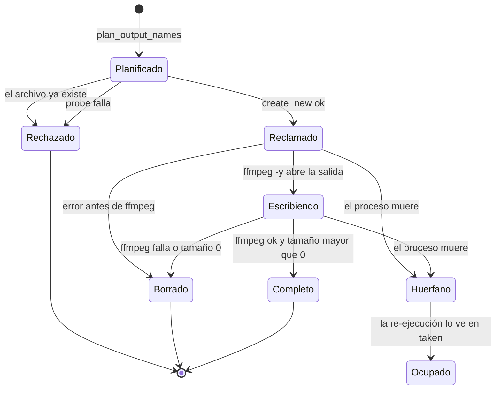

- `Planificado`: el nombre existe solo en memoria.
- `Reclamado`: archivo vacío creado con `create_new`.
- `Escribiendo`: ffmpeg sobrescribe el archivo reclamado (`-y`). En la
  escalera de imágenes, cada peldaño lo reescribe (máquina 3.4).
- `Completo`: éxito. La re-ejecución lo cuenta como ocupado y elige
  `<stem>-web-2`. El E2E lo comprueba (`tests/e2e_shoot_batch.rs:811`).
- `Huerfano`: no hay código que lo trate. Es la parte de la máquina que el
  programa no ve.

**Invariantes.**

- I1. Ninguna salida pisa un archivo existente. Se cumple dos veces: por el
  plan (`src/jobs.rs:138`) y por `create_new` (`src/jobs.rs:151`).
- I2. El mapeo entrada a nombre no depende del orden de los workers. Se
  cumple: el plan corre antes de lanzar workers (`src/jobs.rs:393`).
- I3. Un fallo no deja archivo. Se cumple para todo error que vuelve por
  `Result` (`src/jobs.rs:225-229`). No se cumple si el proceso muere.

**Riesgos.**

- **R1 (verificado, medio).** Si el proceso muere entre `src/jobs.rs:205` y
  `src/jobs.rs:229` (Ctrl-C, cierre de la GUI, apagado), el archivo reclamado
  queda vacío o con bytes parciales. No hay escritura a un temporal con
  renombrado final. En la re-ejecución, `plan_output_names` lo cuenta como
  ocupado (`src/jobs.rs:114-125`), elige `-web-2` y deja el archivo roto al
  lado del bueno. Nada avisa que `-web.mp4` está truncado.
- **R2 (verificado, bajo).** Con Ctrl-C la CLI no llega a
  `src/bin/resizer-cli.rs:315`: el scratch `resizer-cli-<pid>` y sus passlogs
  quedan en el temporal del sistema. El scratch de la GUI nunca se borra; eso
  ya figura en CONCERNS §1.
- **R3 (verificado, bajo; por diseño).** Dos tandas en el mismo directorio de
  salida a la vez (CLI y GUI) ven el mismo `taken`. La segunda en reclamar un
  nombre falla con "already exists" y ese archivo termina en error, sin probar
  otro sufijo. El comentario de `src/jobs.rs:144-147` lo declara intencional.
- Rerun sobre la misma salida: sólido. Las salidas previas quedan intactas y
  la re-ejecución escribe copias nuevas con sufijo.

### 3.3) Pasadas de video y passlog de x264

**Propósito.** Codificar un video en una pasada (CRF) o en dos (ABR con
`max_mb`), compartir las estadísticas entre pasadas y limpiar después.

**Dónde.**

- Contador global: `src/jobs.rs:163`; prefijo: `src/jobs.rs:166-169`.
- Limpieza: `src/jobs.rs:171-183`; comparación por prefijo en
  `src/jobs.rs:177`.
- Bucle de pasadas: `src/jobs.rs:246-254`; limpieza en `src/jobs.rs:255`.
- Argumentos: `src/ffmpeg.rs:476-526` (pasada 1 a `/dev/null` o `NUL` con
  `-pass 1`, pasada 2 con `-pass 2`, mismo `-passlogfile`).

**Codificación.** El índice `i` del bucle de `cmds` es el estado. La
dependencia entre pasadas vive solo en el disco: la pasada 2 necesita los
archivos que escribió la pasada 1 bajo el prefijo. El progreso global se
calcula como `i / passes + f / passes` (`src/jobs.rs:248-250`).

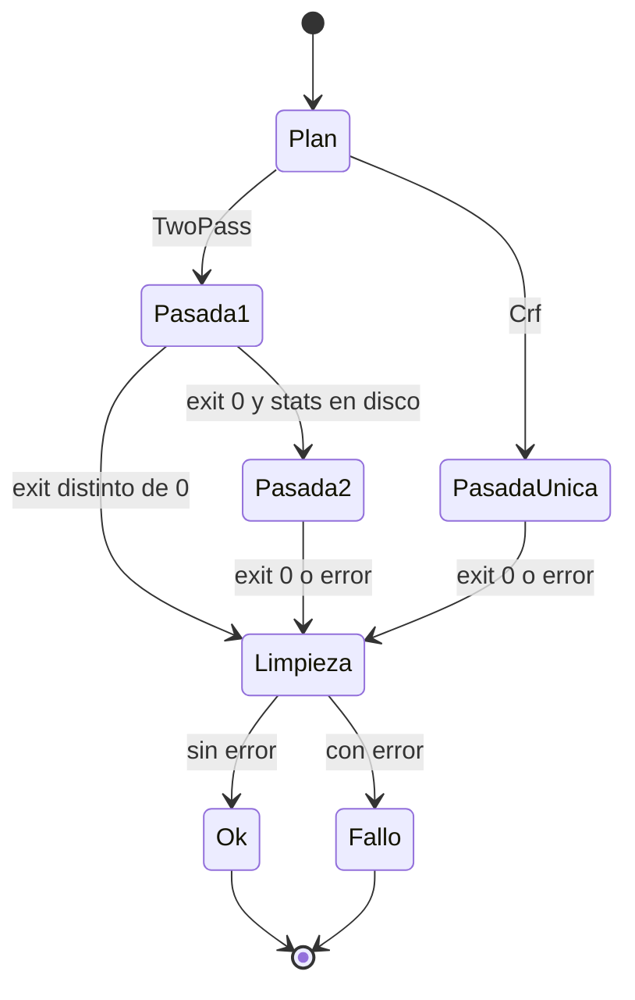

**Invariantes.**

- I1. Cada job usa un prefijo único. Se cumple: PID más contador atómico.
- I2. La limpieza borra solo los archivos de su propio job. **No se cumple**
  (R1).
- I3. El progreso es monótono entre pasadas. Se cumple: `progress=end` lleva
  la pasada 1 a 0.5 y la pasada 2 parte de 0.5.

**Riesgos.**

- **R1 (verificado en el código; efecto hipótesis; medio).** `cleanup_passlog`
  borra todo archivo cuyo nombre empiece con `x264-pass-<pid>-<n>`
  (`src/jobs.rs:177`). Para `n = 1`, ese texto también es prefijo de
  `x264-pass-<pid>-10-0.log`, `-11-`, hasta `-19-`, y de `-100-` en adelante.
  Cuando el job 1 termina, borra los archivos de estadísticas de cualquier job
  10 a 19 que siga vivo. El caso real: un video largo ocupa un worker mientras
  los otros procesan muchos clips cortos. En la GUI el contador nunca se
  reinicia (`src/jobs.rs:163`), así que el solapamiento crece con cada tanda.
  Efecto probable en Linux y macOS: x264 escribe `-0.log.temp` durante la
  pasada 1 y lo renombra al cerrar; si el archivo desaparece, el renombrado
  falla y la pasada 2 no encuentra las estadísticas. Ese archivo termina en
  `Error`. En Windows el borrado de un archivo abierto suele fallar y el error
  se ignora. Arreglo: comparar contra `format!("{name}-")`.
- **R2 (verificado, bajo).** Un kill entre pasadas deja los passlogs en el
  scratch (ver 3.2 R2).

### 3.4) Presupuesto de peso (escalera de imágenes y plan de video)

**Propósito.** Hacer que la salida quepa en `max_mb`. Las imágenes bajan de
calidad peldaño a peldaño. Los videos calculan un bitrate una sola vez.

**Dónde.**

- Selección de rama: `src/jobs.rs:280-330`.
- Rama PNG: `src/jobs.rs:283-298`.
- Escalera JPG/WebP: `src/jobs.rs:300-320`; salida del bucle en
  `src/jobs.rs:315-317`.
- Sin presupuesto: `src/jobs.rs:321-329`.
- Peldaños: `src/plan.rs:345-351`.
- Plan de video: `src/plan.rs:273-304`; piso de 120 kbps en `src/plan.rs:283`;
  reducción de resolución en `src/plan.rs:289-293`; techo en
  `src/plan.rs:296-298`.
- Comprobación previa de WebP: `src/jobs.rs:271-273`.

**Codificación.** `max_mb: Option<f64>` elige el modo. La extensión de la
salida elige la rama (PNG o escalera). En la escalera, el peldaño actual es la
variable `q` del `for`, y el archivo en disco guarda el resultado del último
intento.

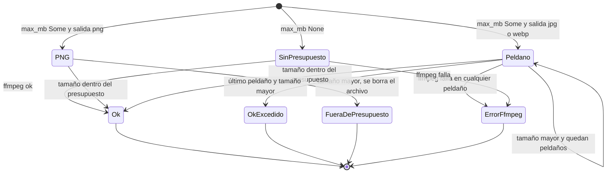

**Invariantes.**

- I1. Con `max_mb`, la salida pesa como máximo `max_mb`. Se cumple para PNG
  (devuelve error). **No se cumple** para JPG/WebP en el último peldaño ni para
  video (R1, R2).
- I2. La escalera siempre termina. Se cumple: lista finita y no vacía
  (`src/jobs.rs:308`).
- I3. Un error de ffmpeg corta la escalera. Se cumple por `?` en
  `src/jobs.rs:311`. No prueba el peldaño siguiente.

**Riesgos.**

- **R1 (verificado, medio).** En el último peldaño la escalera devuelve `Ok`
  aunque el tamaño supere el presupuesto (`src/jobs.rs:315`). La GUI y la CLI
  lo informan como "hecho". La rama PNG, en cambio, falla con un mensaje claro
  (`src/jobs.rs:288-295`). Son dos terminales distintos para la misma
  condición. La escalera nunca baja la resolución, a diferencia del plan de
  video.
- **R2 (verificado, medio).** El plan de video impone un piso de 120 kbps
  (`src/plan.rs:283`) y nadie mide el tamaño final después de codificar
  (`src/jobs.rs:233-257`). Con el preset hover (10 MB, sin audio), el
  presupuesto útil es de unos 80,5 Mbit; a 120 kbps se excede a partir de unos
  671 s de video. Un clip de más de 11 minutos sale por encima de 10 MB y se
  informa como éxito. El README promete "tú solo dices el máximo de MB"
  (`README.md:64-69`).
- **R3 (hipótesis, bajo).** El ABR de dos pasadas puede pasarse unos
  kilobytes del objetivo en clips cortos con mucho movimiento. El margen de
  contenedor del 4 % (`src/plan.rs:209`) lo cubre casi siempre; el E2E solo
  lo comprueba con su fixture.

### 3.5) Instalación de ffmpeg y disponibilidad de herramientas

**Propósito.** Pasar de "sin ffmpeg" a "ffmpeg listo" desde la GUI o la CLI,
con progreso visible y sin dejar binarios rotos.

**Dónde.**

- Estado: `src/server.rs:58` (`tools: Mutex<Option<Tools>>`),
  `src/server.rs:85-92` (`SetupState`: `installing`, `steps`, `error`).
- Arranque: `src/bin/resizer.rs:33`, `src/bin/resizer-cli.rs:117`.
- Endpoint: `src/server.rs:347-388`; guard en `src/server.rs:357-362`; hilo en
  `src/server.rs:366-385`.
- Lógica: `src/install.rs:289-353`; escalación en `src/install.rs:332-347` y
  `src/install.rs:366-374`.
- Disco: `src/install.rs:416-548`; carpeta de trabajo en
  `src/install.rs:419-421`; copia en `src/install.rs:509-517`; verificación y
  borrado en `src/install.rs:526-546`.
- Descubrimiento: `src/ffmpeg.rs:31-42`, `src/ffmpeg.rs:45-75`.
- Caché de encoders: `src/ffmpeg.rs:126-150`.
- Página: `src/ui.html:599-628` (`applyFfmpegState`), `src/ui.html:630-672`
  (`openSetup` con las banderas `_loaded` y `_loading`),
  `src/ui.html:674-681`.
- CLI: `src/bin/resizer-cli.rs:327-370`.

**Codificación.** Tres campos de `SetupState` más `Option<Tools>` forman el
estado. En disco, el estado es la presencia de `bin/ffmpeg`, `bin/ffprobe` y
de la carpeta `download/` bajo `data_dir()`. En la página, el estado es la
clase `open` de `#setup` y las dos banderas de `openSetup`.

| Combinación | Estado real |
|-------------|-------------|
| `tools = None`, `installing = false`, `error = None` | Falta ffmpeg, en espera |
| `installing = true` | Instalando |
| `tools = None`, `installing = false`, `error = Some` | Falló, se puede reintentar |
| `tools = Some` | Listo (`steps` y `error` pueden conservar restos) |

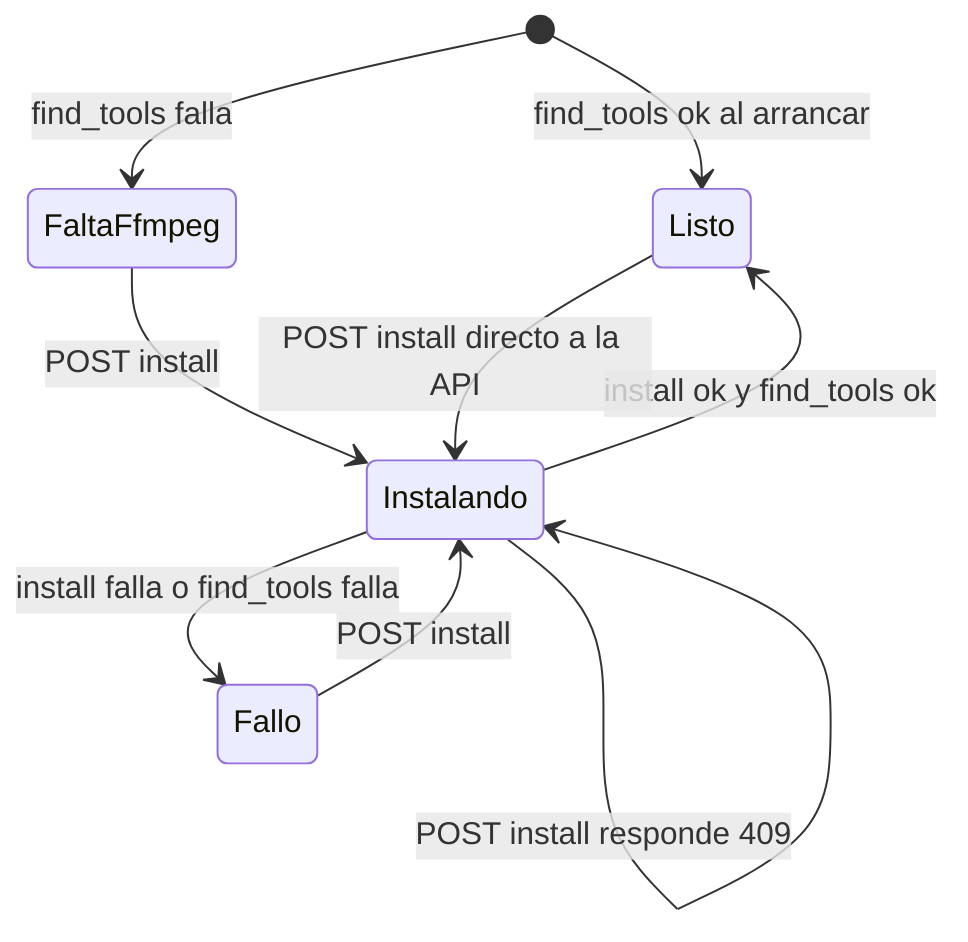

Sub-máquina en disco del método `Download`:

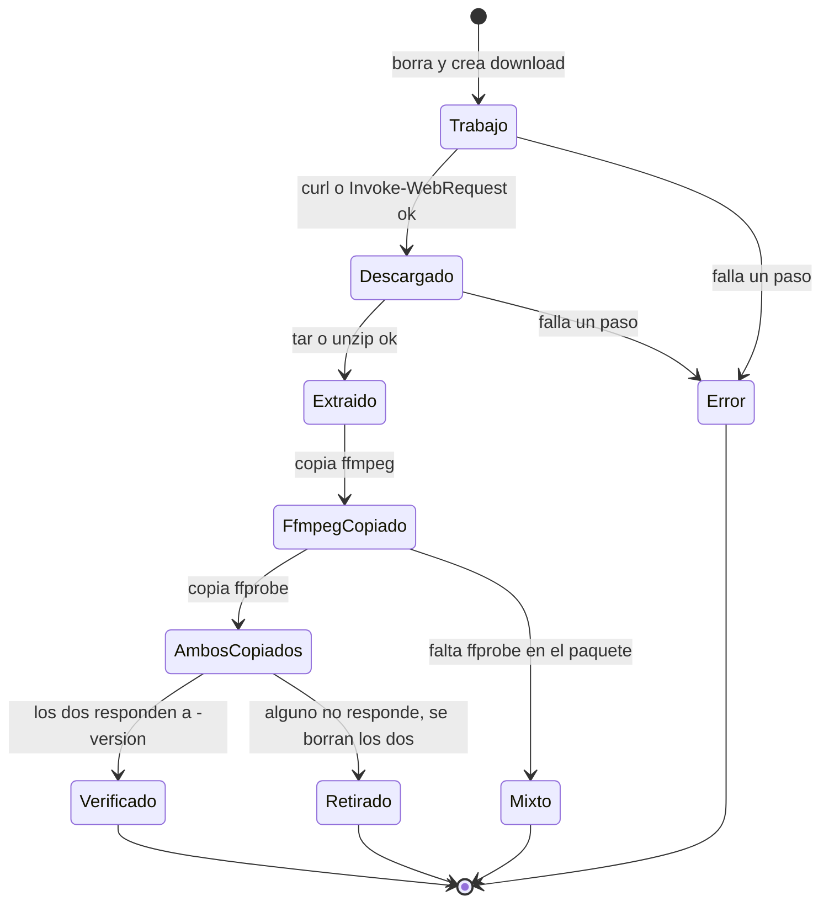

**Invariantes.**

- I1. Una instalación a la vez por proceso. Se cumple con el 409
  (`src/server.rs:357-359`).
- I2. Un binario que no corre nunca se usa. Se cumple en el descubrimiento:
  `find_tools` exige que ffmpeg y ffprobe respondan a `-version`
  (`src/ffmpeg.rs:34`). Por eso el estado `Mixto` y una copia truncada se
  curan solos: el candidato propio se salta y se prueba el siguiente.
- I3. El orden de locks es `state`, luego `setup`, luego `tools`
  (`src/server.rs:318-326`) y `setup`, luego `tools` (`src/server.rs:370-380`).
  No hay ciclo. Sólido.

**Riesgos.**

- **R1 (verificado, bajo).** Con `FFMPEG_PATH` definido, `candidate_paths`
  solo devuelve esa ruta (`src/ffmpeg.rs:51-53`). Si la ruta está rota, la
  instalación termina bien pero `find_tools(None)` falla
  (`src/server.rs:372-376`) y el estado pasa a `Fallo`. Todo reintento repite
  el mismo final. Es un estado sin salida dentro de la app.
- **R2 (hipótesis, bajo).** La CLI `install-ffmpeg` y la GUI comparten
  `data_dir()/download` y lo borran al empezar (`src/install.rs:420`). Dos
  instalaciones simultáneas en procesos distintos se borran el trabajo una a
  otra. El guard de I1 solo vale dentro de un proceso.
- **R3 (verificado, bajo).** La GUI no comprueba que el método esté entre las
  opciones del sistema; la CLI sí (`src/bin/resizer-cli.rs:358`). Un método
  ajeno termina en `Fallo` con "no pude ejecutar"; no causa daño.
- **R4 (verificado, bajo).** `Listo` no tiene guard contra una instalación
  nueva por la API directa. La página no lo permite porque oculta la pantalla
  de setup. Una copia sobre un ffmpeg en uso puede fallar con "Text file busy"
  en Linux (hipótesis).
- **R5 (verificado, bajo).** Si `ffmpeg -encoders` no responde, `has_encoder`
  guarda `true` para siempre en la caché (`src/ffmpeg.rs:147-148`). Un fallo
  transitorio fija el estado hasta reiniciar. El encode mismo luego muestra el
  error real, así que el efecto es solo un mensaje menos claro.
- **R6 (hipótesis, bajo).** Un panic en el hilo de instalación deja
  `installing = true` y toda instalación nueva recibe 409. No se encontró una
  vía concreta de panic.

### 3.6) Vista previa

**Propósito.** Generar una muestra corta con los ajustes actuales y mostrarla
junto al original en un comparador A/B o lado a lado.

**Dónde.**

- Servidor: `src/server.rs:544-572`; archivo en `src/jobs.rs:335-369`
  (`preview-{id}.mp4` o `preview-{id}.<ext>`); servido con filtro de prefijo en
  `src/server.rs:675-685`.
- Página: `state.preview` y `state.previewMode` en `src/ui.html:435-438`;
  `showPreview` en `src/ui.html:851-885`; `closeModal` en
  `src/ui.html:889-895`; montaje en `src/ui.html:827-847`; sincronía A/B en
  `src/ui.html:761-780`; arrastre en `src/ui.html:788-811` (`dragging` y
  `dataset.bound`).

**Codificación.** En el servidor, la previa es un archivo en el scratch que
cada petición sobrescribe. En la página, el estado es `state.preview` (null u
objeto), la clase `open` de `#modal`, el modo (`ab` o `side`) y qué capas
tienen elementos `<video>` montados.

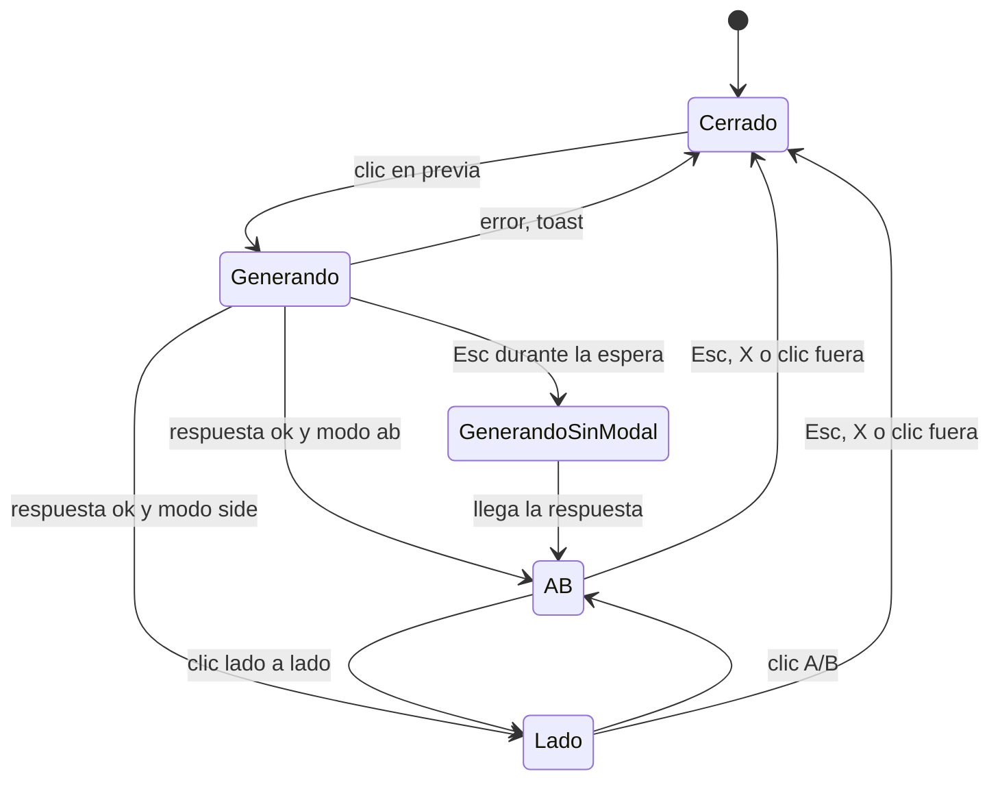

**Invariantes.**

- I1. Solo una de las dos vistas tiene medios montados. Se cumple en
  `mountPreviewMedia` (`src/ui.html:831-846`), y los tests de UI lo
  comprueban.
- I2. Nunca se sirve un archivo fuera del scratch. Se cumple con el prefijo
  `preview-{id}.` y el rechazo de `..` (`src/server.rs:679-680`).

**Riesgos.**

- **R1 (verificado, bajo).** `showPreview` no tiene guard de petición en
  curso ni cancelación. Si la usuaria pulsa Esc mientras se genera, el modal
  se abre igual al llegar la respuesta (`src/ui.html:860-882`). Dos clics en
  "previa" de entradas distintas abren la que responda último.
- **R2 (hipótesis, bajo).** Dos previas del mismo id a la vez (dos clics
  rápidos; el servidor atiende 4 peticiones en paralelo, `src/server.rs:218`)
  ejecutan dos ffmpeg con `-y` sobre el mismo archivo. El navegador puede leer
  un archivo a medio escribir.
- **R3 (verificado, bajo).** Para imágenes, la previa usa la misma escalera
  que la conversión (`src/jobs.rs:365`). Una PNG fuera de presupuesto da un
  error de previa en vez de una muestra. Es coherente con 3.4.
- La sub-máquina A/B (reinicio conjunto, divisor, teclado) es sólida y tiene
  cobertura de navegador.

### 3.7) Ingesta de archivos (subida y carpeta)

**Propósito.** Convertir un archivo del navegador o de una carpeta local en
una `Entry` en `Ready`.

**Dónde.** Subida: `src/server.rs:390-463`. Carpeta: `src/server.rs:465-519`.
Página: `src/ui.html:684-704` (tres workers de subida sobre una cola
compartida) y `src/ui.html:738-746`.

**Codificación.** Presencia de `scratch/in-{id}/` y del archivo copiado, más
la `Entry` en la lista.

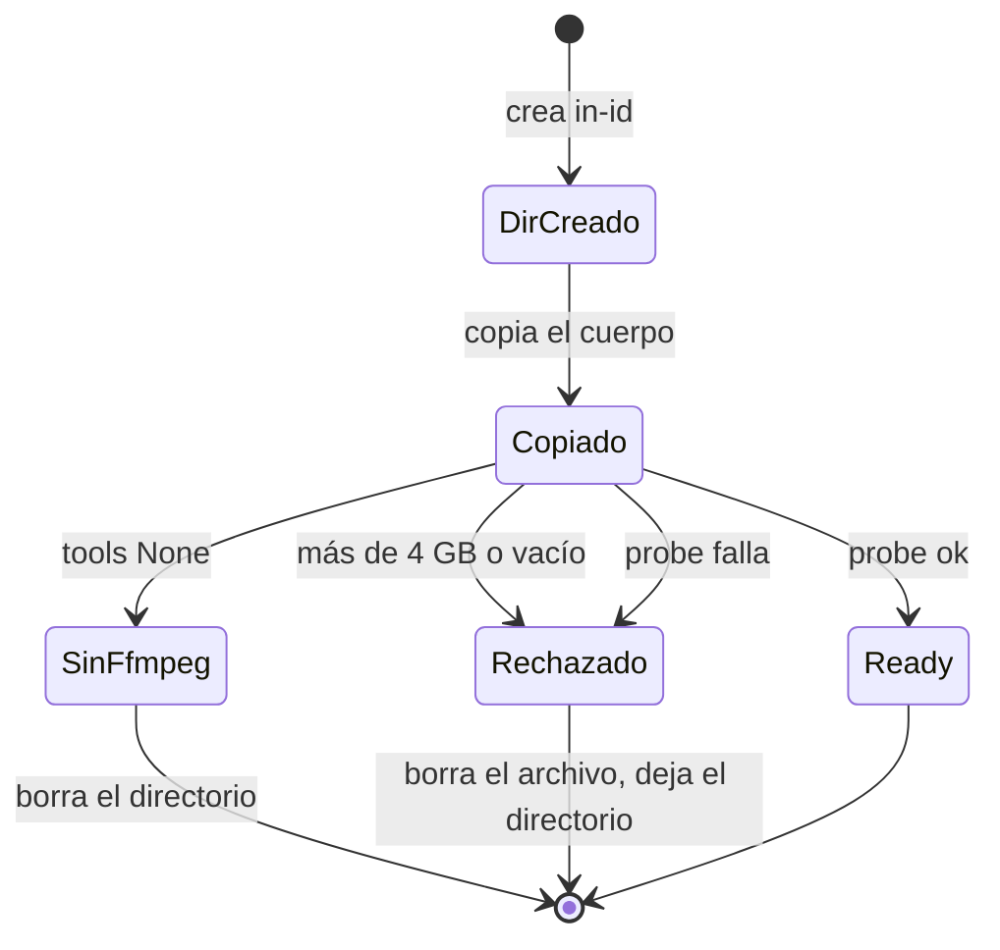

**Riesgos.**

- **R1 (verificado, bajo).** En los rechazos por tamaño, por vacío y por probe,
  el código borra el archivo pero no el directorio `in-{id}`
  (`src/server.rs:424`, `src/server.rs:429`, `src/server.rs:459`). Solo la rama
  sin ffmpeg borra el directorio (`src/server.rs:435`).
- **R2 (hipótesis, bajo).** Si el navegador corta la subida a mitad, la copia
  puede terminar con bytes parciales y sin error. Un video truncado suele
  pasar el probe y entra en `Ready`; la conversión falla o sale más corta.
- **R3 (verificado, bajo).** Con ffmpeg ausente, el servidor copia el archivo
  entero antes de rechazarlo (`src/server.rs:421` antes de
  `src/server.rs:434`).
- Los fallos de probe silenciosos en modo carpeta ya figuran en CONCERNS §2.

### 3.8) Proceso hijo ffmpeg y parser de progreso

**Propósito.** Ejecutar una pasada de ffmpeg, leer `-progress pipe:1` y
traducirlo a una fracción de 0.0 a 1.0.

**Dónde.** `src/ffmpeg.rs:580-630`; hilo de `stderr` en
`src/ffmpeg.rs:597-607`; bucle de `stdout` en `src/ffmpeg.rs:609-621`; espera
en `src/ffmpeg.rs:623-629`. Variante sin progreso: `src/ffmpeg.rs:633-650`.

**Codificación.** El ciclo del hijo vive en el orden de las instrucciones. El
parser no guarda modo entre líneas: cada línea `out_time_us=` emite una
fracción y `progress=end` emite 1.0. Un valor `N/A` no parsea y se ignora.

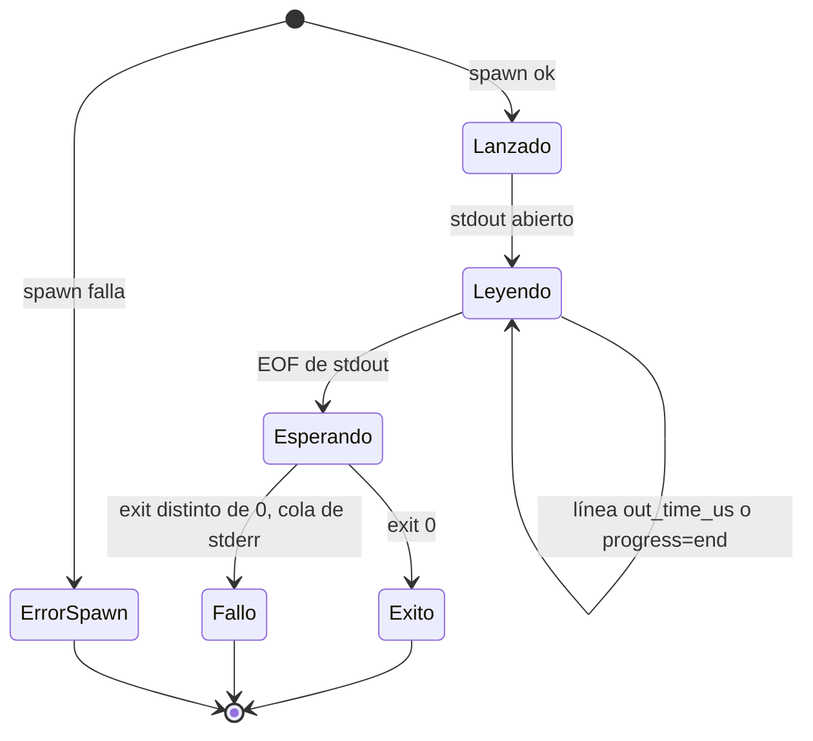

**Invariantes.** `stderr` se drena en otro hilo, así que ffmpeg nunca se
bloquea por una tubería llena. La fracción se limita a `[0, 1]`. Con
`duration_s = 0`, solo `progress=end` emite progreso.

**Riesgos.** La máquina es sólida. Los dos riesgos que tiene ya figuran en
CONCERNS §1: no hay timeout, y no hay cancelación ni muerte de hijos al cerrar
la app (hipótesis: un kill del proceso padre deja ffmpeg vivo escribiendo en
un archivo `Huerfano` de 3.2).

### 3.9) Pool de workers de `run_bulk`

**Propósito.** Repartir N conversiones entre hasta `jobs` hilos y devolver los
resultados en orden de entrada.

**Dónde.** `src/jobs.rs:380-441`; cola llena y cerrada en
`src/jobs.rs:394-398`; `try_recv` en `src/jobs.rs:414-418`; ranura de
resultado en `src/jobs.rs:429`; recolección en `src/jobs.rs:434-440`.

**Codificación.** La cola es el estado global: con índices pendientes, o
vacía y desconectada. Cada ranura de `results` pasa de `None` a `Some`. Cada
worker es un bucle sin estado propio entre iteraciones.

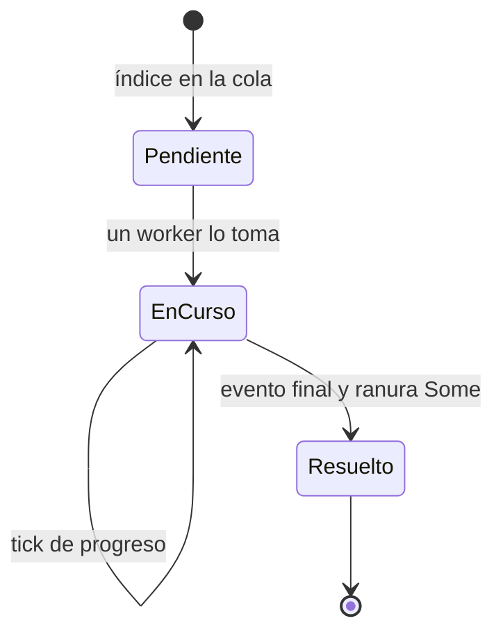

**Invariantes.** La cola se llena entera y el emisor se suelta antes de lanzar
workers, así que `try_recv` nunca ve "vacía pero abierta". Cada índice recibe
exactamente un evento final. `thread::scope` asegura que todos los workers
terminan antes de recolectar.

**Riesgos.** La máquina es sólida. El `flatten()` de `src/jobs.rs:439`
descartaría ranuras `None`, pero eso solo ocurre tras un panic, que el scope
ya propaga. La contención del lock de la GUI en cada tick ya figura en
CONCERNS §4.

### 3.10) Ajustes y modo de control de tasa

**Propósito.** Elegir entre modo "calidad fija" (CRF o calidad de imagen) y
modo "peso máximo", y llevar los ajustes del panel al servidor.

**Dónde.**

- Modelo: `src/plan.rs:57` (`max_mb`), `src/plan.rs:273-304`.
- CLI: `src/bin/resizer-cli.rs:172-186` (`--crf` borra el `max_mb` del preset
  si no hay `--max-mb`).
- Servidor: `src/server.rs:521-542`.
- Página: `src/ui.html:472-485`, `src/ui.html:500-507` (`reflectCap`),
  `src/ui.html:509-518` (debounce de 250 ms), `src/ui.html:525-535` (ratios),
  `src/ui.html:590` (`refresh._init`).

**Codificación.** `max_mb: Option<f64>` es el modo. En la página, el modo es la
casilla `#capOn`, y `reflectCap` habilita uno de los dos controles. El
servidor guarda la última escritura; la página solo lee los ajustes del
servidor en el primer `refresh`.

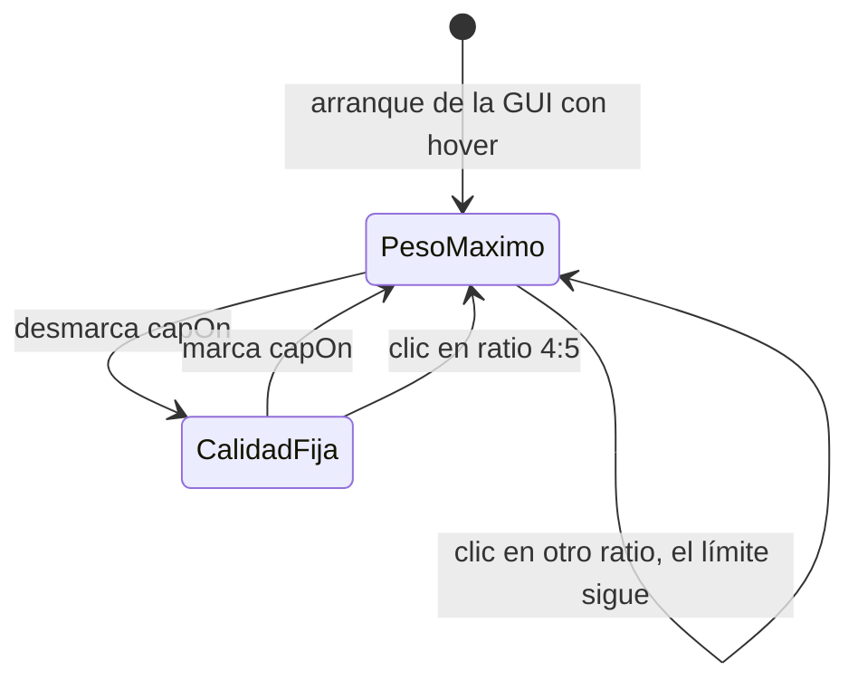

**Riesgos.**

- **R1 (verificado, bajo; quizá intencional).** El botón 4:5 enciende el
  límite de 10 MB y el silencio (`src/ui.html:531`). Los otros ratios cambian
  solo la caja de resolución. Tras pulsar 4:5 y luego 1:1, el límite y el
  silencio siguen activos. Los presets de la CLI, en cambio, son completos
  (`src/plan.rs:102-120`).
- **R2 (verificado, bajo).** Con dos pestañas abiertas, gana la última
  escritura y la otra pestaña no se entera, porque `panelFromSettings` corre
  una sola vez (`src/ui.html:590`).
- Un cambio de ajustes durante una tanda no la afecta: el hilo toma una copia
  al empezar (`src/server.rs:604`). Sólido.

### 3.11) Parsers de EXIF

**Propósito.** Leer la orientación EXIF de JPEG, PNG, WebP y TIFF sin
depender de ffmpeg.

**Dónde.** `src/ffmpeg.rs:222-245` (marcadores JPEG), `src/ffmpeg.rs:248-260`
(chunks PNG), `src/ffmpeg.rs:263-274` (chunks RIFF), `src/ffmpeg.rs:277-313`
(IFD0 de TIFF). Prioridad entre fuentes: `src/ffmpeg.rs:181-185` y
`src/ffmpeg.rs:365-374`.

**Codificación.** El índice `i` y el tipo de marcador o chunk deciden el modo
de cada iteración: byte de relleno, marcador sin longitud, segmento con
longitud, o fin (SOS/EOI, IEND).

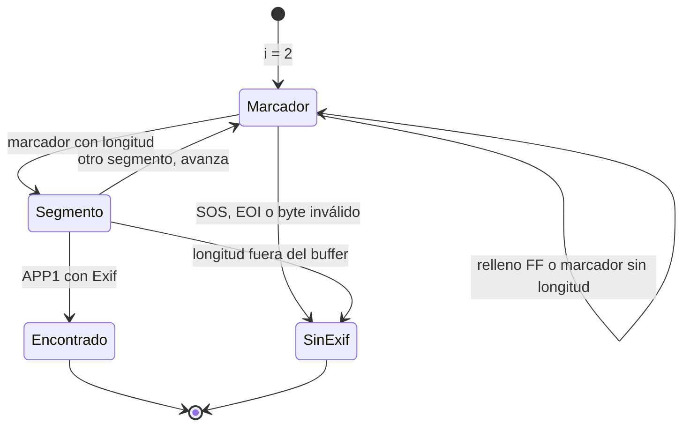

**Riesgos.** Las cuatro máquinas son sólidas. Cada iteración avanza al menos
un byte, todo acceso pasa por `get()` y las sumas críticas usan
`checked_add`. La lectura se limita a 64 MiB por archivo
(`src/ffmpeg.rs:193`); con 16 jobs eso suma hasta 1 GiB en el peor caso
(hipótesis, solo con imágenes enormes).

## 4) Patrones transversales

**Patrones que se repiten.**

1. **Estado repartido entre procesos sin contrato.** La tanda de la GUI vive
   a la vez en `AppState`, en el hilo de fondo y en las variables de la
   página. El contrato HTTP (método y ruta) no está escrito en un solo sitio.
   Por eso R1 de 3.1 pasó inadvertido desde el primer commit.
2. **Booleano más `Option` en lugar de enum.** `converting`,
   `SetupState.installing` con `error`, y `tools: Option` codifican máquinas de
   tres o cuatro estados. Sus estados "fin" dependen de que un hilo llegue a
   su última línea. Un panic deja el booleano fijo en `true` (3.1 R2, 3.5 R6).
3. **El disco como memoria de estado.** Archivo reclamado, passlog, carpeta
   `download/`, directorios `in-{id}` y previas. El código limpia bien en las
   rutas de `Result`, pero no tiene recuperación al arrancar ni escritura con
   renombrado final. Lo que deja un kill queda para siempre.
4. **Escaleras con terminal ambiguo.** La escalera de imágenes y el piso de
   bitrate terminan en `Ok` aunque no cumplan la meta. Solo la rama PNG
   distingue "terminé" de "cumplí".
5. **Comparación por prefijo de texto.** `cleanup_passlog` y el filtro de
   previas comparan nombres por prefijo. En las previas el punto final
   (`preview-{id}.`) cierra el prefijo; en el passlog falta ese separador.
6. **Guardas solo dentro del proceso.** El 409 de instalación y de conversión
   protege a una GUI. La CLI y la GUI juntas comparten `download/` y el
   directorio de salida sin coordinación.

**Riesgos que más conviene atender, en orden.**

1. 3.1 R1: la GUI envía `GET` a `/api/convert`, `/api/clear` y
   `/api/open-output`. Sin arreglo, la GUI no convierte. Añadir un test de UI
   que pulse "Convertir todo" y espere `done`.
2. 3.3 R1: `cleanup_passlog` borra passlogs de otros jobs por prefijo. Puede
   hacer fallar videos sanos en tandas largas de la GUI.
3. 3.4 R1 y R2: salidas por encima de `max_mb` informadas como éxito
   (último peldaño de JPG/WebP y videos de más de unos 11 minutos con hover).
4. 3.2 R1: salidas truncadas tras un kill; la re-ejecución las deja al lado de
   la copia buena sin avisar.
5. 3.1 R2 y 3.5 R6: un panic deja `converting` o `installing` en `true` sin
   salida. Un guard que restaure el booleano al salir del hilo cierra los dos.
